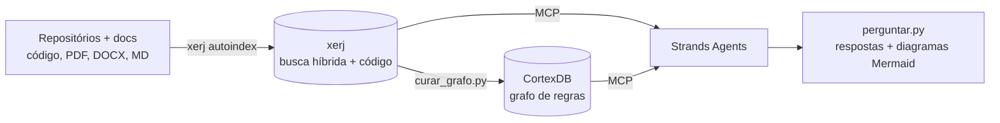

# GetYourBrain

Base de conhecimento de regras de negócio.

Agentes de IA que respondem dúvidas sobre regras de negócio e geram diagramas
a partir de repositórios de código e documentação. Toda resposta traz a fonte (arquivo:linha).

## Arquitetura



| Peça | Papel | Por quê |
|---|---|---|
| **xerj** | Indexa o material bruto (código com tree-sitter, PDF, DOCX, XLSX…) e faz busca full-text, vetorial e híbrida com `arquivo:linha` | Resolve a ingestão, que o CortexDB não tem pronta |
| **CortexDB** | Guarda o conhecimento *curado*: regras, serviços, tabelas e as relações entre eles | O grafo permite análise de impacto e diagramas confiáveis |
| **Strands Agents** | Orquestra os agentes e fala com os dois servidores via MCP | Suporta Bedrock, Anthropic e Ollama, com guardrails e observabilidade |

### Agentes

- **orquestrador**: recebe a pergunta e delega aos especialistas.
- **pesquisador**: busca no xerj (só leitura).
- **cartógrafo**: consulta o grafo no CortexDB (só leitura).
- **diagramador**: gera Mermaid usando apenas fatos com fonte.
- **curador** (`curar_grafo.py`): lê o código via xerj e grava regras e relações no grafo. É o único agente que escreve.

## Instalação

1. **xerj**: siga a instalação no [repositório do projeto](https://github.com/xerj-org/xerj). Em banco, prefira baixar o binário do GitHub Releases e validar o checksum em vez de usar `curl | sh`.
2. **CortexDB MCP**: baixe o binário `cortexdb-mcp` do [GitHub Releases](https://github.com/liliang-cn/cortexdb/releases) e rode `cortexdb-mcp --doctor --self-test`.
3. **Python** (3.10 ou mais novo):
   ```bash
   python3 -m venv .venv && source .venv/bin/activate
   pip install -r requirements.txt
   cp .env.example .env   # ajuste provedor, modelo e caminhos dos binários
   ```

## Uso

```bash
# 1. Sobe o xerj com autenticação e indexa o material
scripts/subir_xerj.sh ~/repos/servico-pix ~/docs/regras-pix

# 2. Confere quais ferramentas MCP cada servidor expõe
python perguntar.py --ferramentas

# 3. Cataloga regras de um domínio no grafo
python curar_grafo.py --arquivo temas.exemplo.txt

# 4. Faz perguntas (diagramas Mermaid são salvos em saida/)
python perguntar.py "Qual o limite do PIX noturno e onde ele é validado?"
python perguntar.py "Gere um diagrama de sequência do fluxo de PIX agendado"
python perguntar.py   # modo interativo
```

## Pontos a validar

- **Nomes das ferramentas MCP.** As listas em `servidores_mcp.py` vêm da documentação dos projetos. Se `--ferramentas` mostrar nomes diferentes, ajuste as listas. O script avisa quando falta alguma.
- **ID do modelo no Bedrock.** Confira no console qual ID ou perfil de inferência do Claude está liberado na conta.
- **Formato do `knowledge_graph_upsert`.** O curador segue o esquema que o próprio servidor MCP descreve. Revise as primeiras gravações com `serve_graph_3d` ou consultas SPARQL.

## Segurança (ambiente bancário)

- Nunca rode o xerj com `--insecure` fora da sua máquina. O script sobe com autenticação e o nó escuta só em `127.0.0.1`.
- O rerank externo do xerj (Jev) envia trechos para servidores de terceiros. Ele vem desligado e o GetYourBrain não o usa.
- O código vai para o provedor do modelo. Use Bedrock na conta do banco (com `BEDROCK_GUARDRAIL_ID`) ou Ollama local, conforme a política de segurança da informação.
- `dados/`, `saida/` e `.env` estão no `.gitignore`.
