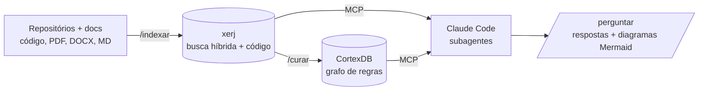

# GetYourBrain

Base de conhecimento de regras de negócio.

O Claude Code responde dúvidas sobre regras de negócio e gera diagramas a partir de repositórios de código e documentação. Toda resposta traz a fonte (arquivo:linha). O projeto é autocontido: busca e grafo rodam na máquina, sem enviar dados para fora e sem API key própria (usa o login do Claude Code).

## Arquitetura



| Peça | Papel |
|---|---|
| **xerj** (`vendor/xerj`) | Indexa o material bruto (código com tree-sitter, PDF, DOCX, XLSX…) e faz busca full-text, vetorial e híbrida com `arquivo:linha` |
| **CortexDB** (`vendor/cortexdb`) | Guarda o conhecimento *curado*: regras, serviços, tabelas e as relações entre eles |
| **Claude Code** | Orquestra os subagentes e fala com os dois servidores via MCP (`.mcp.json`) |

Os dois servidores são compilados do código em `vendor/`, com todas as funções que enviavam dados para fora removidas. Eles rodam com ambiente limpo e, no macOS, dentro de um sandbox sem rede externa. Detalhes em [`vendor/README.md`](vendor/README.md).

### Subagentes (`.claude/agents/`)

- **pesquisador**: busca no xerj (só leitura).
- **cartografo**: consulta o grafo no CortexDB (só leitura).
- **diagramador**: gera Mermaid usando apenas fatos com fonte.
- **curador**: lê o código via xerj e grava regras e relações no grafo. É o único que escreve.

A sessão principal do Claude Code faz o papel de orquestrador, seguindo `/perguntar`.

## Instalação

Precisa de Rust (`cargo`), Go e Claude Code.

```bash
scripts/build.sh   # compila xerj e cortexdb em bin/ e roda a verificação de isolamento
```

A primeira compilação do xerj leva cerca de 10 minutos. As dependências vêm do crates.io e do proxy do Go, travadas por `Cargo.lock` e `go.sum`. Depois de compilado, nada mais acessa a rede.

## Uso

Abra o Claude Code **na raiz do projeto** (o `.mcp.json` usa caminhos relativos):

```text
/indexar ~/repos/servico-pix ~/docs/regras-pix
/curar --arquivo temas.exemplo.txt
/perguntar Qual o limite do PIX noturno e onde ele é validado?
/perguntar Gere um diagrama de sequência do fluxo de PIX agendado
```

O xerj sobe sozinho quando o Claude Code inicia o servidor MCP. Os diagramas são salvos em `saida/`. Também dá para perguntar direto, sem o comando; as regras do `CLAUDE.md` valem do mesmo jeito.

Para conferir o isolamento a qualquer momento: `scripts/verificar_isolamento.sh`.

## Pontos a validar

- **Formato do `knowledge_graph_upsert`.** O curador segue o esquema que o próprio servidor MCP descreve. Revise as primeiras gravações com `serve_graph_3d` ou consultas SPARQL.
- **Busca semântica.** Sem download de modelo, o xerj usa o embedder léxico. Para o neural, veja `vendor/README.md`.

## Segurança (ambiente bancário)

- O xerj sobe com autenticação e escuta só em `127.0.0.1`. A chave fica em `dados/xerj/admin.key`.
- Rerank externo, embeddings por proxy, Corpus Hub, relatórios automáticos, túnel público e S3 foram removidos do código, não só desligados.
- O CortexDB só conecta em loopback, mesmo que `OPENAI_API_KEY` ou outras chaves estejam no seu shell.
- O projeto bloqueia WebFetch e WebSearch (`.claude/settings.json`).
- **O que ainda sai:** as perguntas e os trechos encontrados vão para o modelo do Claude Code, como em qualquer sessão. Confira com a segurança da informação se o plano contratado atende à política do banco.
- `bin/`, `dados/` e `saida/` estão no `.gitignore`.
